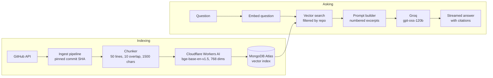

# Ask-a-Repo

[](https://github.com/gautam-gopal/ask-a-repo/actions/workflows/ci.yml)

Ask questions about any public GitHub repository and get answers that cite exact file and line ranges, linked to the commit that was indexed.

## Live

- **App:** https://ask-a-repo.onrender.com
- **Try the demo:** click "Try the demo" on the login page. No signup. It is read-only and has two pre-indexed repositories. To index your own repository, sign up.
- **First load:** the app runs on a free host that sleeps after 15 idle minutes. The first request after that can take about a minute. The UI shows a "waking up" banner.

<!-- TODO: add the demo video link here after recording -->

## What it does

A signed-in user pastes a public GitHub repository URL. The server indexes the supported files in the background. The user then asks questions in plain English. Each answer cites the excerpts it used, and each citation links to the file and line range on GitHub, pinned to the indexed commit, so the link stays valid after the repo changes.

- Cited answers with GitHub links pinned to the commit SHA
- Streaming answers over Server-Sent Events, with a Stop button
- Per-user repositories (3 at most), removed after 7 days
- Background indexing with live status and progress
- Read-only demo mode with no signup

Supported files: `js`, `jsx`, `ts`, `tsx`, `json`, `md`. Test files are skipped by default (see Evaluation).

## Architecture



### How a question is answered

1. The request is validated, then ownership and "ready" status of the repo are checked, along with rate limits and the daily budget.
2. The question is embedded with the same model used for the chunks.
3. `$vectorSearch` runs with a `repoId` pre-filter. Up to 8 chunks come back, adjacent ones are merged, and the top 5 are kept.
4. If the best score is below 0.795, the app answers "not found" and does not call the LLM.
5. A prompt is built from numbered excerpts (budget about 3000 estimated tokens) plus the last 4 answered turns. Excerpts are treated as untrusted data.
6. Groq streams tokens over SSE. The server validates `[n]` citations against the excerpts sent, saves the exchange, and sends a final event with sources as GitHub links.

## Tech stack

| Layer      | Choice                                                   | Why                                                           |
| ---------- | -------------------------------------------------------- | ------------------------------------------------------------- |
| API        | Node 22, Express 5                                       | Familiar, enough for this app                                 |
| Client     | React 19, Vite, plain CSS                                | Fast build, no styling time                                   |
| Deploy     | One Render free service; Express serves the built client | One origin, no CORS, simple cookies                           |
| Database   | MongoDB Atlas M0                                         | Free, vector search built in, one system for users and chunks |
| Embeddings | Cloudflare Workers AI, `bge-base-en-v1.5`                | Free daily allowance, no server RAM or CPU                    |
| LLM        | Groq, `gpt-oss-120b` (fallback `gpt-oss-20b`)            | Free, fast, supports streaming                                |
| Auth       | JWT in httpOnly cookie, bcryptjs, zod                    | Token not readable by page JS                                 |
| Tests / CI | Vitest, supertest, GitHub Actions                        | Free, standard                                                |

Only `embeddings.js` knows Cloudflare and only `llm.js` knows Groq, so swapping a provider is a one-file change.

## Engineering highlights

- **Citation format bug (D-049).** The model sometimes wrote `【1】` instead of `[1]`. Both are now accepted and validated against the excerpts actually sent, so an invented `[7]` never becomes a link. `items[7]` in code is left alone.
- **Silent 512-token truncation (D-022).** The embedding model cuts input at 512 tokens without error. The 1500-character chunk cap is an estimate, not a guarantee. This is documented and counted, not hidden.
- **Decommissioned model (D-039).** Groq retired the Llama models used originally (2026-08-16). Migrating to `gpt-oss-120b` / `gpt-oss-20b` was a config and one-file change because the provider is isolated.
- **Reasoning tokens ate the output budget (D-073).** A detailed question stopped with `finish_reason: length` at 700 output tokens. The cap is now 1500, and truncation is a distinct error that is never saved as an answer.
- **SSE behind a proxy (D-060 to D-067).** `X-Accel-Buffering: no`, a 15 s heartbeat, abort of the Groq call on client disconnect (listening on `res`, not `req`), and a stream only counts as complete with both `finish_reason: stop` and `[DONE]`.
- **Crash recovery without a queue (D-025, D-027).** Status field as the only job state. On boot, anything still `queued` or `indexing` is marked `failed` and its chunks are deleted.
- **A missing import hidden by error handling (B-001).** The streaming route imported a function that did not exist; the failure surfaced only as an SSE `error` event. The test now asserts the mocked stream function was called.
- **Provider died mid-build (D-019).** The free Jina embedding key ran out. Switching to Cloudflare Workers AI touched one file.

## Evaluation

Retrieval only, no LLM. A question is a hit at k when any expected file is in the top k results (file-level, not line-level).

| run                                     | chunks | hit@1 | hit@3 | hit@5 |   MRR |
| --------------------------------------- | -----: | ----: | ----: | ----: | ----: |
| baseline (tests indexed)                |    873 | 36.7% | 73.3% | 80.0% | 0.547 |
| B2 (tests excluded, production default) |    560 | 46.7% | 86.7% | 86.7% | 0.650 |

Settings: window 50, overlap 10, max 1500 characters, file path in the embedded text, no query prefix, adjacent hits merged. Model `@cf/baai/bge-base-en-v1.5`, Atlas `$vectorSearch`.

**Exclude-tests trade-off.** Four extra questions whose answers live in test files were scored separately. With test files excluded: 0 of 4 hit. With test files indexed: 4 of 4 hit at rank 1. So "how is X tested?" questions do not work with the production default.

Caveats: 30 on-topic and 8 off-topic questions over two repositories, written by me, so one question is 3.3 points of hit@5. B2 was chosen after seeing these same questions. Excluding tests also removes 36% of chunks, which makes retrieval easier on its own, and none of the 30 headline questions target test files. Four B2 failures remain. Details: [server/eval/FINDINGS.md](server/eval/FINDINGS.md).

The not-found threshold (0.795) passes 30/30 on-topic questions and rejects 4/8 off-topic ones. It was tuned on the same questions, and its margin is 0.004, so treat it as provisional.

## Security and limits

Summary (full tables in [docs/PROTECTIONS.md](docs/PROTECTIONS.md)):

- httpOnly, SameSite=Lax cookie; 7-day JWT; bcryptjs; same 401 for unknown email and wrong password
- Every repo query filters by `_id` and `userId`; other users' repos return the same 404 as missing ones
- Only `https://github.com/{owner}/{repo}` is accepted, so the server only calls GitHub
- Rate limits per IP and per user; daily embedding (8000 estimated neurons) and LLM (500 requests) budgets; 200-account cap
- Caps: 3 repos per user, 150 files, 200 KB per file, 2 MB per repo
- CSP without `unsafe-inline`; model output rendered as plain text; only `github.com` URLs become links
- Request logs contain no bodies, cookies or emails; secrets are redacted from error logs

## Known limitations

- Rate-limit counters, active-ingest tracking and concurrency limits are in memory. They reset on restart and do not work across multiple instances.
- No refresh tokens or revocation. A stolen JWT can stay valid for up to 7 days.
- No CSRF token; protection relies on SameSite=Lax.
- Signup reveals existing email addresses through HTTP 409.
- One shared GitHub token and one shared Cloudflare token serve all users.
- Daily budgets are estimates. The LLM budget counts requests, not tokens.
- Free-tier cold starts can take about a minute.
- Ingest jobs do not resume after a restart; interrupted jobs are marked failed.
- Repositories indexed before test exclusion was added keep their test chunks until re-added.
- `/healthz` is public and reports database state and uptime.
- Evaluation is file-level only, on a small sample written by the author.
- The score threshold was tuned on the same small sample.
- Line-based chunking ignores syntax, so a chunk can start or end mid-function.
- Demo sessions have no follow-up context (all visitors share one user).

## What I would build next

- **Hybrid search:** keyword plus vector with rank fusion, to help exact-identifier questions.
- **AST-aware chunking:** split on functions and classes instead of fixed line windows.
- **Shared rate-limit store:** move counters out of process memory so multiple instances work.
- **Private repositories:** GitHub OAuth with per-user tokens.

## Run locally

**Prerequisites:** Node 22 (CI uses 22), a MongoDB Atlas M0 cluster, and free accounts at GitHub, Cloudflare and Groq.

**Atlas vector index.** On the `chunks` collection create an index named `chunks_vector` with this definition (check the Atlas docs if the UI differs):

```json
{
  "fields": [
    {
      "type": "vector",
      "path": "embedding",
      "numDimensions": 768,
      "similarity": "cosine"
    },
    { "type": "filter", "path": "repoId" }
  ]
}
```

**Environment.** Copy `.env.example` to `.env` in the repo root and fill in:

| Variable                        | Where to get it                                                                     |
| ------------------------------- | ----------------------------------------------------------------------------------- |
| `MONGODB_URI`                   | Atlas, "Connect" on your cluster. Must end with the database name `/askarepo`       |
| `JWT_SECRET`                    | Generate 32+ random characters yourself                                             |
| `GITHUB_TOKEN`                  | GitHub, Settings, fine-grained personal access token, public repositories read-only |
| `CLOUDFLARE_ACCOUNT_ID`         | Cloudflare dashboard (sidebar or URL)                                               |
| `CLOUDFLARE_API_TOKEN`          | Cloudflare, API token with Workers AI permission                                    |
| `GROQ_API_KEY`                  | console.groq.com                                                                    |
| `DEMO_ENABLED`, `DEMO_PASSWORD` | Optional. `DEMO_PASSWORD` is 12+ random characters, required only if demo is on     |

All other variables are optional and documented in `.env.example`.

**Commands:**

```bash
# install
npm --prefix server install
npm --prefix client install

# development (two terminals; open http://localhost:5173)
npm run dev
npm run dev:client

# tests (server; all external services are faked)
npm --prefix server test

# production build and start (Express serves client/dist)
npm run build
npm start

# demo data: dry run first, then --yes to write (needs DEMO_PASSWORD)
node server/scripts/seed-demo.js <repo-url-1> <repo-url-2>
node server/scripts/seed-demo.js <repo-url-1> <repo-url-2> --yes

# retrieval evaluation (dry run without --yes)
node server/scripts/eval.js --yes
```
